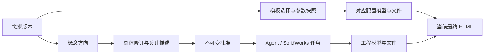

# 后端职责与接入说明

更新：2026-11-16。本文区分“源码已有调用”“本地预览实现”和“真实服务尚未接入”；不把候选接口当作已经存在的服务。

## 1. 当前接入程度

| 能力               | 当前实际情况                                                                                       | 后端仍需完成                                                      |
| ------------------ | -------------------------------------------------------------------------------------------------- | ----------------------------------------------------------------- |
| 平台认证与项目读取 | `lib/auth-context.tsx`、生成 SDK、`LiveRepository.list/get` 有同源 Cookie 调用；本轮未联调真实服务 | 部署认证与项目服务，验证 Cookie、401/403、跨账户隔离              |
| V8 登录与工作空间  | `/v8` 为本地演示账号、模块与项目存储                                                               | 真实短信/注册/找回密码，工作空间与模块项目归属持久化              |
| 需求与附件         | 文本/结构化字段、TXT/Markdown 在浏览器保存                                                         | 文件上传、PDF/DOCX 解析、需求版本、附件授权与来源关系             |
| 模板与适配         | 本地目录、声明参数、真实 GLB 查看及确定性配置导出                                                  | 授权模板目录、匹配、capabilities/schema、服务端适配保存及文件生成 |
| 专业定制           | 确定性样例方向、分支和修订；无真实 LLM 生成                                                        | Agent 编排、多概念生成、图片/模型资产、多轮修改                   |
| 批准与 CAD         | 本地冻结批准记录、样例任务与来源模型结果                                                           | 不可变批准、任务队列、Agent → SolidWorks worker → 工程文件        |
| 工程验证           | 当前 `validationStatus` 为 `not_run`                                                               | 真实检查项目、检查结果和验证证据；未执行不能标为通过              |
| 交付               | 当前来源检查、最终 HTML、GLB 与离线阅读导出                                                        | 服务端最终成果事务、对象存储、权限与签名下载、版本归属校验        |
| 常驻助手           | 受控本地页面/查看器指令，有真实执行回执；不是开放式 Agent                                          | 对话服务、工具权限、结构化命令、任务提交与反馈                    |
| Simcore / Deployx  | 模块展示与组合；Simcore 暂未开放，Deployx 无业务页                                                 | 后续独立服务，当前不是 Embodex 交付的必需依赖                     |

`LiveRepository` 的 V8 创建、需求保存、模板适配、概念生成/修改/批准、CAD、最终报告、上传和下载目前抛出 `CAPABILITY_UNAVAILABLE`。这些阻断是有意的，不应通过启用样例或返回伪成功来绕过。

## 2. 前端分层与真实接口入口

- `components/v8/*`：页面、模型与交互；不直接拼接生产业务 URL。
- `lib/v8/types.ts`：V8 前端领域类型与 `V8Repository` 接口。
- `lib/v8/repository.ts`：`PreviewRepository` 和 `LiveRepository`，后端接入的主要适配位置。
- `lib/v8/state.ts`、`delivery-packages.ts`、`report-model-source.ts`：前置条件、来源与当前/历史关系。
- `lib/api/generated/*`：随工程保留的生成 SDK；不要为了匹配猜测接口而直接手改生成代码。
- `lib/api/client.ts`、`lib/hub/api.ts`、认证、Equipment 和既有 Embodex 模块：原平台调用链，保留兼容。
- `next.config.ts`：可通过服务端 `PLATFORM_BACKEND_ORIGIN` 代理同源 `/api/v1/*`。

源码已有的认证 `/api/v1/auth/*`、项目 `/api/v1/projects/*`、资源 `/api/v1/resources/*`、Workspace、Embodex Legacy/Hub、Equipment 等路径仍需与后端确认版本并联调。旧 conversation/thread、confirmation 或 publication 不能未经语义确认就映射为 V8 分支、批准或新 CAD 结果。

## 3. 前端需要的能力契约

以下为已有 `V8Repository` 方法对应的服务能力，**不是新增接口路径已部署的声明**。HTTP 路径、鉴权和响应包装由后端与 adapter 协商。

| 前端方法/能力      | 请求的关键内容                                     | 服务端返回或持久化内容                                            |
| ------------------ | -------------------------------------------------- | ----------------------------------------------------------------- |
| `list/get/create`  | 当前身份、项目类型、名称/初始需求、幂等键          | 授权项目、最新状态与明确资源归属                                  |
| `upload`           | 文件、MIME、大小、用途                             | 上传资产、解析状态、文本/结构化结果、来源引用和错误               |
| `saveRequirements` | 完整目标、用途、约束、来源附件、幂等键             | 不可变 `RequirementRevision`；旧版本保留                          |
| `chooseRoute`      | 项目、模板/定制路线                                | 项目路线与兼容状态；不自动创建无关 CAD 任务                       |
| 模板目录/匹配      | 需求版本、筛选、授权范围                           | 真实模型 URL、许可、参数 schema、匹配理由、编辑能力               |
| `useTemplate`      | 模板版本、需求版本、合法参数快照、幂等键           | 已保存配置与文件状态；复用或执行适配任务由实际能力决定            |
| `generateConcepts` | 需求版本、数量、参考资产与参数、幂等键             | Task；完成后独立 ConceptBranch/ConceptRevision/素材，允许部分成功 |
| `refine`           | 明确 branch/revision、修改要求、受支持参数、幂等键 | 新修订与新描述；不覆盖父版本或其他方向                            |
| `approve`          | 精确 branch/revision/description、需求与参数快照   | 不可变 Approval，含批准者、时间和完整来源                         |
| `startCad`         | Approval ID、幂等键                                | CADRun + Task；严格使用该批准描述与参数                           |
| `syncTask`         | 项目、任务 ID 或未知受理的提交意图                 | 权威任务状态、结果引用、错误与当前文件状态                        |
| `finalizeReport`   | 当前来源集合/指纹                                  | 满足条件时返回唯一最终 HTML Artifact；否则返回具体缺失步骤        |
| `download`         | Artifact ID                                        | 服务端授权、格式/大小/状态/摘要、短期可用地址或流；过期可刷新     |
| Journey            | 项目与分页/游标                                    | 需求、方向、修订、批准、执行、文件和关键决策事件                  |

现有预览类型采用 `assetKey` 和本地能力目录。真实 Agent 可返回图片或任意受支持模型资产，adapter 应映射真实资产引用、媒体类型、组件元数据和参数 schema；不要要求后端只能输出本地七个样例 key。

## 4. 不可变来源链

服务端至少保存以下归属关系：

- `projectId`、`requirementId`、`branchId`、`revisionId`、`descriptionId`。
- `approvalId`、`cadRunId`、`taskId`、模板/模型资源及其版本。
- 参数名称、单位、合法范围、`parameterSnapshot` 与模型导出 recipe/版本。
- Artifact MIME、大小、摘要、状态、权限、来源关系和创建时间。

CAD 的 `sourceDescription` 必须与批准描述一致，不能重新解释最新需求后悄悄替换。工程结果与报告必须匹配同一需求、批准、模型及参数。新需求或实质修改形成新来源，旧结果保存为历史，不覆盖或自动改归当前版本。

最终 HTML 的幂等键应基于服务端当前来源指纹，使用事务或唯一约束防止刷新、并发确认、重复同步创建多份。同一来源无需重复生成；来源变化后等待新的所有必要条件。旧项目缺少 HTML 也走相同条件。

## 5. Agent 与 SolidWorks 的真实执行

建议接入步骤如下，不代表此仓库已有这些服务：

1. API 验证用户对项目和批准记录的权限，锁定不可变描述与参数。
2. 以稳定幂等键创建 CADRun 和任务；返回任务 ID，不等待长任务完成后才响应。
3. 后台 Agent 根据锁定输入生成建模计划，派发给具备许可证和受控权限的 SolidWorks 执行环境。
4. Worker 执行建模，采集日志和失败原因；按实际能力输出原生 CAD、STEP 等工程文件，以及浏览器可读 GLB。未生成的格式不能作为可下载成果列出。
5. 上传到对象存储，校验文件可读性、大小、摘要、元数据和来源。任务成功与文件就绪是两个独立条件。
6. 对需要的工程检查执行真实验证，并保存检查范围和结果。不能仅因导出 GLB 成功就声称可制造。
7. 服务端发布就绪的工程成果；当前来源全部满足后生成最终 HTML。前端通过轮询或协商的 SSE 接收更新。

模板复用无需加入上述 CAD 队列。超出模板能力的结构变化才转入专业定制或受支持的后端工程流程。

## 6. 任务、错误与恢复

任务状态包括 `queued/running/partial/succeeded/failed/unknown`，文件状态包括 `uploading/validating/ready/failed/missing/expired`。前端需要明确的阶段文本、错误码、可重试性和结果引用。

- 请求超时不代表未受理；先通过提交意图/幂等键查询，不能盲目再次创建 CAD。
- 断网后补拉权威状态；重试失败任务时保留旧失败记录和已有有效成果。
- SSE 可选，须有事件 ID、重连和权威刷新；当前 V8 生产适配尚未接入 SSE。
- 多账户/多项目切换时隔离响应与资源。后端必须独立检查权限，不能依赖浏览器传入的 `ownerId`。
- 下载前由服务端授权；签名地址过期不应更改成果来源。校验中/失败文件不能伪装 ready。

## 7. HTML、模型与存储

当前报告内容由绑定的需求版本、批准描述、对应模型和参数快照映射，官网代码只提供布局和交互。任务安排是基于已有字段的确定性组织，不是真实 Agent 规划。缺失事实使用“待确认”，缺失财务/性能输入保持空白。

后端最终报告应保存来源指纹及模板版本；如采用 Agent 撰写，必须校验其引用事实和生成数字，不能引入无依据的性能、预算或其他示例场景。前端保留对应来源检查。

在线报告中的临时测算不写回源 Artifact。HTML 下载可离线阅读，PDF 由浏览器打印；无需为当前需求新增 PDF 服务。三维文件独立下载，原生 CAD 需要真实 Worker 产出。

`/api/v8-preview/models/:assetKey?recipe=...` 是本机开发专用 GLB 配置导出端点：白名单资产、受支持参数、来源信息、大小与 SHA-256、有限内存缓存。它不是业务后端、持久化资产平台或 SolidWorks 服务；生产环境返回 404。

浏览器本地存储包含演示项目、版本、对话、模块配置和示例账号。本次文件清理不删除这些数据。生产应迁移至授权服务端存储，不能直接将演示存储视为业务数据库。

## 8. 接入与验收顺序

1. 核对平台认证、项目和资源 SDK；配置后端代理并验证权限。
2. 接入需求/上传、模板目录和适配能力，先闭合模板路线。
3. 接入 Agent 的多概念、修订、批准，验证不可变来源链。
4. 接入 CAD Worker、任务恢复和就绪文件，再开放真实工程按钮。
5. 接入最终报告、下载与历史；执行并发幂等、上游变更、失败、校验中、跨账户和过期链接测试。
6. 验证模型加载与释放、手机操作、键盘、断网恢复。保留现有预览测试，但必须增加真实服务集成测试。

不要在生产使用 `123/123`、固定短信码或预置工程成功。生产模式没有 V8 服务时继续显示真实能力缺口；`pnpm build` 成功仅证明前端可构建，不证明后端已接通。
